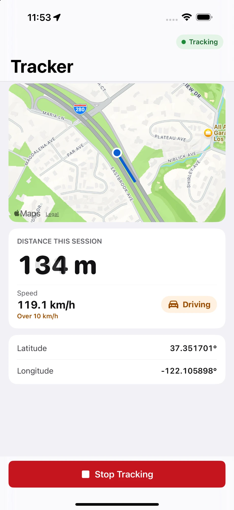
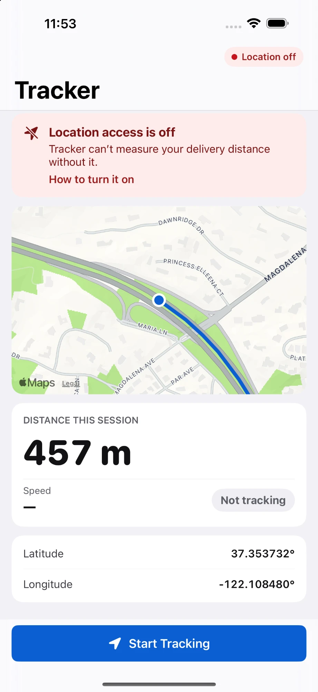
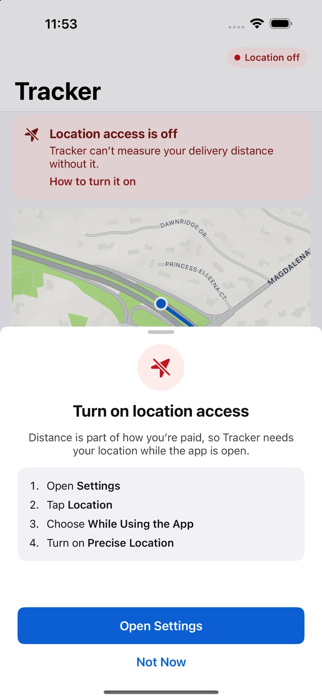
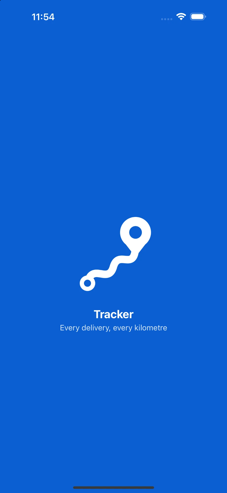

# Tracker

A SwiftUI app for delivery couriers. Start a tracking session to see your route on a map, your current coordinates, the distance travelled, your speed, and whether you're walking or driving. Stop the session to keep the final distance on screen.

## Screenshots

| Tracking | Location off | Turn on location | Splash |
|---|---|---|---|
|  |  |  |  |

## Requirements

- Xcode 26 or later
- iOS 18.0+
- No external dependencies

## Running the app

1. Open `Tracker/Tracker.xcodeproj`.
2. Select the `Tracker` scheme and an iPhone simulator.
3. Run (⌘R), then tap **Start Tracking** and allow location access.

### Simulating movement

In the Simulator, use **Features → Location**. **City Run** and **Freeway Drive** both move faster than 10 km/h, so they show **Driving**.

The project also includes two routes in `Tracker/Simulation/`:

- `Walk.gpx`: a 7-minute walk around one block at about 5 km/h, which shows **Walking**.
- `Drive.gpx`: a 7-minute drive around a few blocks at about 40 km/h, which shows **Driving**.

To use one, run the app from Xcode, tap **Start Tracking**, then choose **Debug → Simulate Location → Walk** (or **Drive**).

## Running the tests

In Xcode, press ⌘U. Or from the terminal:

```bash
xcodebuild test -project Tracker/Tracker.xcodeproj -scheme Tracker -destination 'platform=iOS Simulator,name=iPhone 16 Pro'
```

There are 50 tests (60 cases with the parameterised ones), written with Swift Testing:

- `DistanceTrackerTests` (15): the distance rules. The first location, adding and summing distance, GPS drift while standing still, slow walking, GPS jumps, starting again when the first point was a stale fix, invalid and low accuracy, readings from before the session started (whatever their accuracy), and readings that arrive out of order.
- `LocationServiceTests` (10): how the location manager is set up, starting when access is allowed, asking for permission first, starting once allowed, ignoring permission changes when not tracking, passing on locations in order, reporting denied before and during tracking, stopping, and a new session ending the previous stream. They use `MockLocationManager`.
- `HomeViewModelTests` (25): the idle state, tracking, stopping, a new session resetting everything, both denied-permission paths, the banner, refreshing after Settings, kilometres from 1 km, ignored readings, cached locations from a previous trip, recovering from a stale first point, speed (including none across a GPS jump), the "Over 10 km/h" text, Walking / Driving, and working out speed when the device reports none. They use `MockLocationService` and a fixed clock.

## Architecture

MVVM in SwiftUI, with dependencies passed in through protocols so they can be mocked in tests.

- **Model:** `LocationEvent` (a location, or permission denied), `TrackingStatus` (idle, tracking, location off) and `TrackingActivity` (none, walking, driving).
- **Services:** `LocationService` wraps `CLLocationManager` and streams its updates as an `AsyncStream<LocationEvent>`. It sits behind `LocationServiceProtocol` and takes its manager through `LocationManagerProtocol`. `DistanceTracker` is a plain struct with the distance rules.
- **View model:** `HomeViewModel` reads the location events, passes them to `DistanceTracker`, works out speed and activity, and exposes everything the screen shows as `@Observable` state.
- **Views:** `HomeView` is generic over `HomeViewModelProtocol`. Components such as `StatusPillView` and `ActivityBadgeView` pick their colours with a `switch` on the state the view model works out. `SplashView` shows the logo and app name at launch, then fades into Home.

```
Tracker/
├── Tracker/
│   ├── App/                     @main entry point, splash then Home
│   ├── Helpers/                 VoidResult and other closure types
│   ├── Styles/                  spacing, radius, font size and text style tokens
│   ├── Resources/               colour catalog (light and dark), app icon, logo
│   └── Modules/
│       ├── Home/
│       │   ├── Models/          LocationEvent, TrackingStatus, TrackingActivity
│       │   ├── Services/
│       │   │   ├── Location/    LocationService + protocol, LocationManagerProtocol
│       │   │   └── Distance/    DistanceTracker
│       │   └── UI/
│       │       ├── Components/  StatusPillView, ActivityBadgeView, TrackingBannerView, RouteMapView
│       │       └── Scenes/
│       │           ├── Main/    HomeView, HomeViewModel + protocol
│       │           └── Info/    LocationDeniedView
│       └── Splash/
│           └── UI/Scenes/Main/  SplashView
├── TrackerTests/
│   ├── Mocks/                   MockLocationService, MockLocationManager, CLLocation test helpers
│   └── Modules/                 mirrors Tracker/Modules
└── Simulation/                  Walk.gpx, Drive.gpx
docs/screenshots/                README screenshots
```

**How a location update reaches the screen:**

1. `LocationService` receives updates from `CLLocationManager` through its delegate and sends each one out as a `LocationEvent` (`.location` or `.authorizationDenied`).
2. `HomeViewModel` reads the events with `for await` inside a `Task`. **Start Tracking** starts the task; **Stop Tracking** cancels it and stops the updates.
3. Each location goes through `DistanceTracker`, which decides whether it counts towards the distance. Counted locations are also added to the route on the map. A cached location from before the session started is ignored completely.
4. The view model updates the location, speed and activity. Its `@Observable` state changes, and `HomeView` redraws.

## Assumptions

- **Permission:** foreground only ("When In Use"), no background tracking.
- **Map:** Apple Maps, since the brief allows no external dependencies.
- **Distance** is measured with `CLLocation.distance(from:)` and shown in metres below 1 km and kilometres above.
- **A reading is ignored when:**
  - its accuracy is worse than 20 m (too rough to trust),
  - it's from before the session started (the first update is often a cached location),
  - it moved less than the GPS drift threshold (the larger of 5 m or the two readings' accuracies added together),
  - it implies more than about 200 km/h (a GPS jump). If the next reading agrees with the jumped-to one, the last counted point was the bad one, so measuring starts again from there.
- **Walking / Driving:** a single 10 km/h threshold.
- **Sessions:** Start resets the distance to 0, Stop keeps the final distance on screen. Sessions aren't saved.
- **Denied permission:** a banner and a help sheet that links to Settings. Permission is checked again when the app returns to the foreground.

## Time spent

About 3 hours.

## What I'd improve with more time

1. Use `CLLocationUpdate.liveUpdates()`, which natively returns an `AsyncSequence`.
2. A summary screen after Stop, with distance, duration and the route.
3. A GPS accuracy indicator and a weak-signal warning.
4. Background tracking, for when the courier locks the phone mid-delivery.
5. Testing on iOS 18 and iOS 26, smaller and larger iPhones, and a real device on an actual walk and drive.
6. A coordinator to own navigation (splash to Home, the location help sheet, and future screens such as the session summary), so views and view models don't decide where to go next.

## Tools used

| Tool | Used for |
|---|---|
| Xcode | Building, running and debugging with the iOS SDK (SwiftUI, Core Location, MapKit). |
| iOS Simulator | UI states, the permission and denied flows, light and dark mode, and simulated walks and drives. |
| Swift Testing | Unit tests for the distance logic, the location service and the view model. |
| Claude Code | Scaffolding the baseplate (styles, colours, helpers). Writing the location service, distance logic, some components and tests, all reviewed and tested by me. The UI design, components and icons mockup ([view the mockup](https://claude.ai/artifact/UHYrpXoUvctq4wUQ5xgmej#page-dcb81aee8d83)). Generating the app icon and splash logo. README documentation. |
